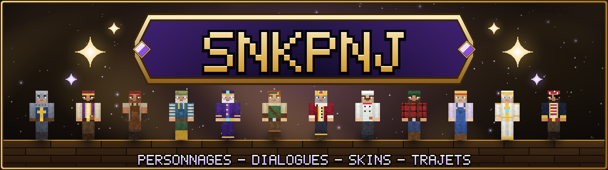
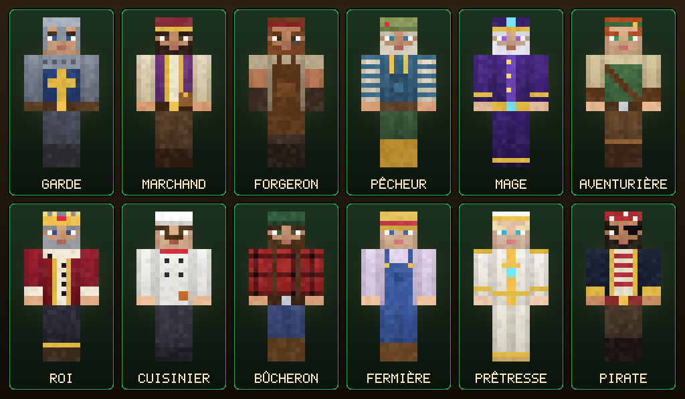
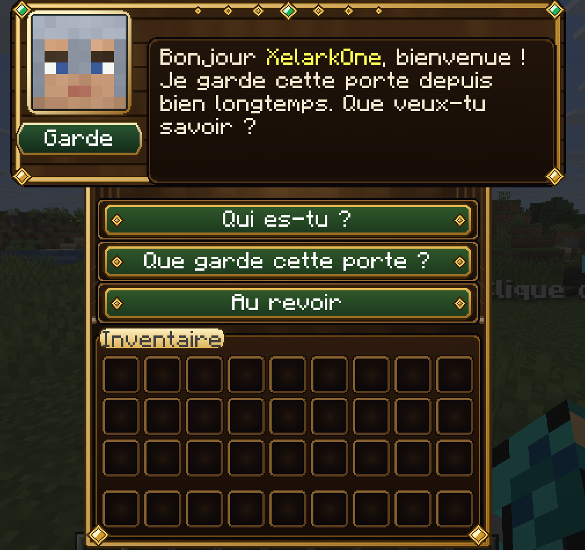
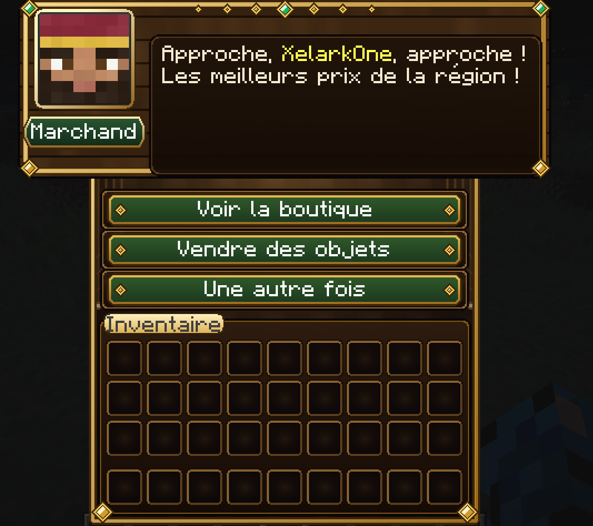
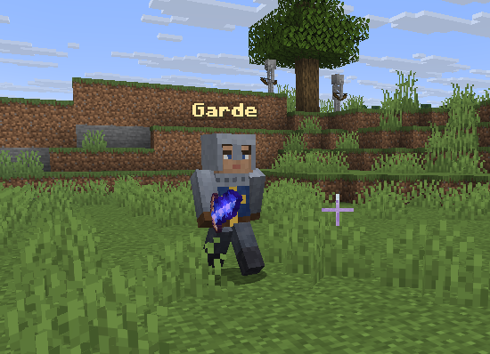
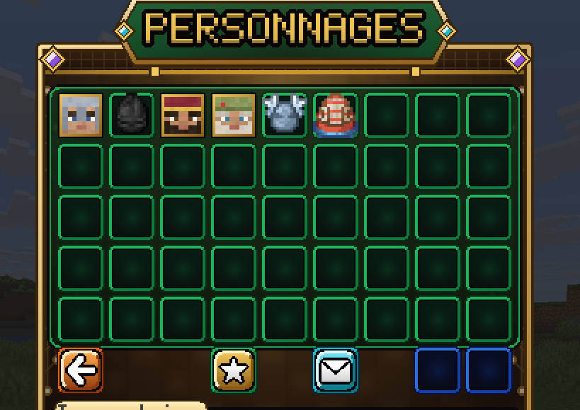
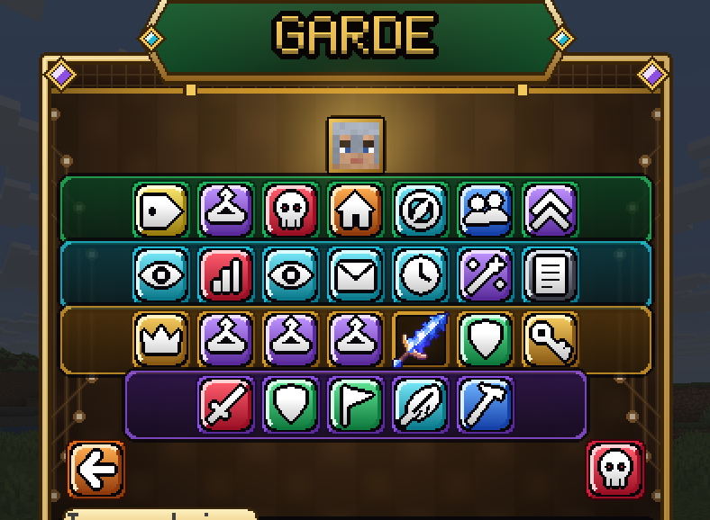
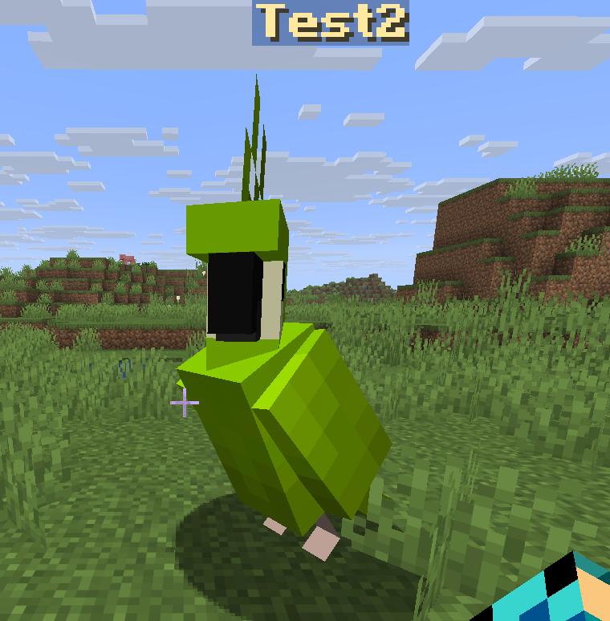

<b>Des personnages vivants pour ton serveur : skins, dialogues dessinés, trajets et actions, tout en jeu.</b> 
Plugin Minecraft pour serveurs <b>Paper 1.21.9 à 26.3</b>, par <b>SnkAlex</b>.

<a href="#-fonctions">Fonctions</a> •
<a href="#-les-12-skins">Skins</a> •
<a href="#-captures">Captures</a> •
<a href="#-commandes">Commandes</a> •
<a href="#-compatibilité">Compatibilité</a> •
<a href="#-lobtenir">L'obtenir</a>

---

## ✨ Fonctions

### 🧍 Des personnages
- Un vrai corps de joueur, avec **12 skins originaux** ou celui de **n'importe quel joueur**
- Ou une **créature du jeu** : chat, villageois, golem, poisson…
- **Poses** : debout, accroupi, assis, allongé, nage
- Taille, lueur, armure, objets en main
- Il **regarde les joueurs** qui s'approchent

### 💬 Des dialogues dessinés
- **Portrait** du personnage, texte et réponses dans un écran dessiné
- Étapes, conditions et actions, avec autant de réponses que tu veux
- Les textes longs et les nombreuses réponses sont répartis sur plusieurs pages, tout seuls
- Écrits **en jeu** ou dans des fichiers

### 🚶 De la vie
- **Trajets** : il marche de point en point, en boucle ou en aller-retour, et s'arrête quand on lui parle
- **Bulles** : il dit une phrase au hasard de temps en temps
- **Nom sur plusieurs lignes**, différent pour chaque joueur

### 🎯 Des actions
- Commande, dialogue, téléportation, message, son, titre, changement de serveur…
- Au clic droit, au clic gauche ou sur une réponse
- Conditions par grade, permission, monde ou n'importe quelle valeur : un personnage peut n'être visible que par certains joueurs

### 🛠️ Tout en jeu
- Un menu pour créer, placer, habiller et régler chaque personnage
- Équiper un personnage ne prend pas ton objet

### 🔌 Pour les développeurs
- `PnjAPI` : dialogues avec du code, marques au-dessus des têtes (« ! », « ? »…) propres à chaque joueur
- `PnjClicEvent` : un événement au clic, annulable

---

## 🎨 Les 12 skins

 Les 12 skins, dessinés pour SnkPNJ (aperçu hors du jeu)

---

## 📸 Captures

<table>
<tr>
<td align="center" width="50%"> Un dialogue et ses réponses</td>
<td align="center" width="50%"> Le marchand ouvre la boutique</td>
</tr>
<tr>
<td align="center"> Le garde, un objet en main</td>
<td align="center"> La liste des personnages</td>
</tr>
<tr>
<td align="center"> Les réglages d'un personnage</td>
<td align="center"> Une créature : un perroquet géant</td>
</tr>
</table>

---

## ⌨️ Commandes

| Commande | Effet |
|---|---|
| `/pnj` | La liste des personnages |
| `/pnj creer <nom> [type]` | Crée un personnage ou une créature à ta place |
| `/pnj editer [nom]` | Règle un personnage (le plus proche sans nom) |
| `/pnj skin <nom> <pseudo>` | Skin d'un joueur ou skin dessiné |
| `/pnj dialogue <nom> <dialogue>` | Choisit son dialogue |
| `/pnj trajet <nom>` | Ajoute un point à son trajet |
| `/pnj parler <joueur> <nom> [dialogue]` | Ouvre un dialogue (console) |
| `/pnj ici`, `aller`, `copier`, `supprimer`, `reload` | Gestion |

**Permission :** `snkpnj.admin`.

---

## 🧩 Compatibilité

| | |
|---|---|
| **Versions** | 1.21.9 à 26.3, un seul fichier pour toutes |
| **Testé sur** | Paper 1.21.11, 26.2 et 26.3 |
| **Serveur** | Paper |
| **Java** | 21 ou plus (celui de ta version de Paper) |
| **Pack de ressources** | Fourni et conseillé, pour les skins dessinés et les dialogues. Sans lui : skins de joueurs et dialogues en menu classique |
| **Facultatif** | Vault, PlaceholderAPI, LuckPerms (conditions par grade) |

**Va plus loin avec les autres plugins Snk** (facultatifs) :
- **[SnkQuetes](https://github.com/SnkStudio/SnkQuetes)** : des quêtes données par les personnages, avec « ! » et « ? » au-dessus des têtes
- **[SnkInterface](https://github.com/SnkStudio/SnkInterface)** : plaques de grade et icônes dans les noms, menus ouverts par un personnage
- **[SnkCosmetiques](https://github.com/SnkStudio/SnkCosmetiques)** : chapeaux et masques sur les personnages
- **[SnkMarche](https://github.com/SnkStudio/SnkMarche)** : un marchand qui ouvre la boutique
- **[SnkMetiers](https://github.com/SnkStudio/SnkMetiers)**, **[SnkClans](https://github.com/SnkStudio/SnkClans)**, **[SnkPass](https://github.com/SnkStudio/SnkPass)** : un personnage pour chaque menu

---

## 📦 Ce que tu reçois
- Le plugin (`.jar`)
- Le pack de ressources : les 12 skins, l'écran de dialogue et les menus
- Le guide d'installation et le guide complet, en français

Aucune connaissance en code n'est nécessaire : tout se règle en jeu.

---

## 📩 L'obtenir

Le plugin n'est pas en téléchargement libre. Pour le prix, une question ou une démonstration :

➡️ **[Écris-moi ici](../../issues/new/choose)** (il faut un compte GitHub, c'est gratuit)

> Les messages sont **publics** : n'écris ni adresse e-mail, ni mot de passe, ni information de paiement. On passe ensuite en privé.

---

© SnkAlex. Tous droits réservés. Voir <a href="LICENSE.md">la licence</a>. 
Ce plugin n'est pas un produit officiel Minecraft. Il n'est ni approuvé par Mojang ou Microsoft, ni associé à eux.

